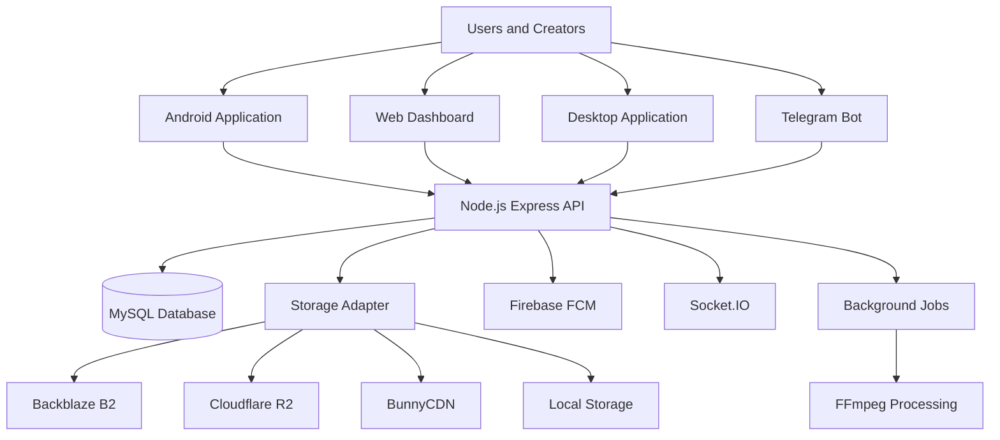
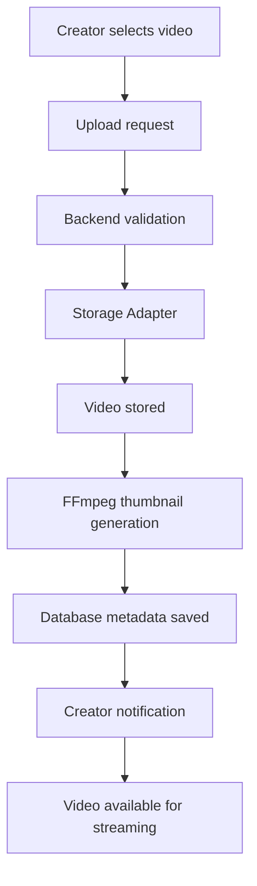

# 🎬 Vidora

<h3 align="center">Video Hosting & Monetization Platform</h3>

<p align="center">
  A full-featured video platform for creators, publishers, and OTT startups — independently engineered from architecture to deployment.
</p>

<p align="center">
  
  
  
  
  
  
</p>

<p align="center">
  <a href="#-overview">Overview</a> ·
  <a href="#-features">Features</a> ·
  <a href="#-screenshots">Screenshots</a> ·
  <a href="#-architecture">Architecture</a> ·
  <a href="#-installation">Installation</a> ·
  <a href="#-roadmap">Roadmap</a>
</p>

---

## 🚀 Overview

**Vidora** is a complete video hosting and monetization ecosystem designed for content creators, video publishers, and OTT startups.

It provides a unified platform where creators can upload videos, manage content, share files, grow subscribers, and generate revenue from views.

Consumers can discover and watch content through Android, Web, and Desktop applications.

The entire platform was independently designed and developed, covering backend architecture, database design, Android engineering, frontend development, desktop applications, storage infrastructure, and deployment automation.

### Platform Highlights

- 📱 Native Android application
- 🌐 React-based creator dashboard
- 🖥️ Cross-platform desktop application
- ⚙️ REST API and real-time backend
- ☁️ Multi-provider cloud storage architecture
- 💰 Creator monetization and subscriptions
- 🤖 Telegram upload automation

---

## ✨ Features

### 🔐 Authentication & User Management

- OTP-based authentication and email verification.
- JWT access and refresh token rotation.
- User profile and avatar management.
- Referral system.
- Account restriction and banned-user detection.

### 🎥 Video Hosting & Streaming

- Video uploads with automatic thumbnail generation using FFmpeg.
- HTTP Range-based video streaming.
- Local and cloud storage support.
- File sharing through unique share tokens.
- File copying between Vidora accounts without duplicating stored files.
- View-count fraud prevention with a one-view-per-hour-per-IP rule.
- Soft deletion while preserving creator earnings records.

### 💰 Creator Monetization

- Dynamic earning rate per verified view.
- Minimum payout threshold.
- Referral-based earning bonuses.
- Creator revenue tracking.
- Google Play subscription plans:
  - ₹199 / month
  - ₹499 / 3 months
  - ₹1,499 / year
- Dynamic AdMob configuration from the administration panel.

### 👥 Creator & Subscription System

- Subscribe and unsubscribe from creators.
- Individual notification preferences.
- YouTube-style subscription feed.
- Latest and Popular content sorting.
- Creator profiles with avatars and statistics.
- New upload notifications for subscribers.

### 📡 Real-Time Communication

- Socket.IO-powered live view counts.
- Firebase Cloud Messaging.
- In-app notification system.
- Unread notification tracking.
- Automatic subscriber notifications.

### ☁️ Cloud Storage Infrastructure

Built around a pluggable Storage Adapter Pattern.

Supported providers:

- Local Storage
- Cloudflare R2
- Backblaze B2
- BunnyCDN
- Custom S3-compatible storage

<badge color="success">Currently active</badge>

**Backblaze B2**

Storage providers can be switched through the administration panel without redesigning the entire storage layer.

### 🤖 Telegram Bot Integration

- Link Telegram accounts using API keys.
- Upload videos directly through Telegram.
- Automatically generate Vidora share URLs.
- Copy files between Vidora accounts using `/copy`.
- Send FCM notifications to subscribers after bot uploads.

---

## 🖥️ Platform Ecosystem

| Platform | Technology | Purpose |
|---|---|---|
| Backend API | Node.js, Express | Core business logic and APIs |
| Web Dashboard | React 19, TypeScript | Creator and administration interface |
| Android | Java, ExoPlayer | Native video consumption |
| Desktop | Tauri v2, Rust | Cross-platform desktop client |
| Database | MySQL 9 | Persistent application data |
| Storage | Backblaze B2 | Video and file storage |
| Real-time | Socket.IO | Live updates |
| Notifications | Firebase FCM | Push notifications |
| Automation | Telegram Bot API | File upload and management |

---

## 🛠️ Technology Stack

### Backend & APIs

<p>
  
</p>

### Frontend

<p>
  
</p>

### Android Development

<p>
  
</p>

### Desktop & Systems

<p>
  
</p>

### Database & Infrastructure

<p>
  
</p>

**Additional Technologies**

FFmpeg · ExoPlayer · Retrofit · Glide · AdMob · Google Play Billing · Socket.IO · Backblaze B2 · BunnyCDN · Nodemailer · JWT

---

## 🏗️ Architecture



### Video Upload Lifecycle



---

## 📂 Project Structure

```text
Vidora/
│
├── backend/
│   ├── src/
│   │   ├── controllers/
│   │   ├── routes/
│   │   ├── models/
│   │   └── middleware/
│   ├── uploads/
│   ├── .env.example
│   └── package.json
│
├── vidora-andoid/
│   └── Android Application
│
├── vidora-desktop/
│   ├── src/
│   ├── src-tauri/
│   └── package.json
│
├── web_dashboard/
│   ├── src/
│   ├── public/
│   └── package.json
│
└── README.md
```

---

## 🚀 Installation

### Prerequisites

- Node.js 24
- MySQL 9
- Java Development Kit
- Android Studio
- Rust toolchain
- Tauri v2 prerequisites
- FFmpeg
- Git

### 1. Clone Repository

```bash
git clone https://github.com/mynkdev-21/Vidora.git

cd Vidora
```

### 2. Backend Setup

```bash
cd backend

npm install

cp .env.example .env
```

Configure database, authentication, Firebase, SMTP, and storage credentials in `.env`.

Start the backend:

```bash
npm start
```

### 3. Web Dashboard

```bash
cd web_dashboard

npm install

npm run dev
```

### 4. Android Application

Open `vidora-andoid/` in Android Studio.

Configure the required Firebase and API settings, sync Gradle, and run on an Android device or emulator.

### 5. Desktop Application

```bash
cd vidora-desktop

npm install

cargo tauri dev
```

---

## ⚙️ Environment Configuration

Example backend `.env`:

```env
PORT=3000

DB_HOST=localhost
DB_USER=root
DB_PASSWORD=
DB_NAME=videora

JWT_SECRET=

SMTP_HOST=
SMTP_USER=
SMTP_PASS=

FIREBASE_PROJECT_ID=

BASE_URL=
FRONTEND_URL=
```

Configure the actual environment variables required by your deployment.

Never commit real API credentials, Firebase private keys, or production secrets.

---

## 📈 Scaling Architecture

The following table represents an infrastructure planning roadmap, not measured production capacity or guaranteed costs.

| Target Users | Planned Infrastructure |
|---|---|
| 1K | Current deployment |
| 5K | Redis caching for trending and profiles |
| 20K | PM2 cluster and database indexing |
| 50K | MySQL read replicas and Cloudflare CDN |
| 100K+ | Load balancer, multiple Node.js instances, Redis cluster |

### Planned Infrastructure

```text
             Cloudflare CDN
                    |
              Load Balancer
                    |
          +---------+---------+
          |         |         |
        Node 1    Node 2    Node 3
          |         |         |
          +---- Redis Cluster
                    |
              MySQL Primary
                    |
               Read Replicas
                    |
              Backblaze B2
```

Actual infrastructure requirements depend on concurrent viewers, video bitrate, storage usage, request volume, and CDN cache efficiency.

---

## 🗺️ Roadmap

- [ ] Cloudflare CDN integration
- [ ] Video quality selector
- [ ] Production deployment with SSL
- [ ] Production AdMob configuration
- [ ] Google Play Store release
- [ ] Play Billing product configuration
- [ ] Apple Developer account and signed macOS application

---

## 🔒 Security & Reliability

- JWT-based authentication.
- Refresh token rotation.
- API request validation.
- Account restriction mechanisms.
- View-count abuse prevention.
- Storage abstraction.
- Secure environment-based configuration.

Production deployments should also enforce rate limiting, upload validation, authorization checks, secure token storage, and payment verification.

---

## 📄 License

Distributed under the MIT License.

See the `LICENSE` file for details.

---

## 📬 Contact & Connect

Have a question, collaboration idea, or want to discuss the project? Feel free to connect.

<p align="center">
  <a href="mailto:mayanksingh3132@gmail.com">
    
  </a>
  <a href="https://linkedin.com/in/mynk-dev">
    
  </a>
  <a href="https://t.me/mayankdeveloper">
    
  </a>
  <a href="https://github.com/mynkdev-21">
    
  </a>
</p>

| Platform | Link |
|---|---|
| 📧 Email | mayanksingh3132@gmail.com |
| 🌐 Portfolio | [mayankdeveloper.site](https://mayankdeveloper.site) |
| 💼 LinkedIn | [mynk-dev](https://linkedin.com/in/mynk-dev) |
| 🏢 Company | [AmTech INFO](https://amtechinfo.online) |
| ✈️ Telegram | [@mayankdeveloper](https://t.me/mayankdeveloper) |
| 🐙 GitHub | [mynkdev-21](https://github.com/mynkdev-21) |

---

<p align="center">
  <b>Built from architecture to deployment with ❤️ by Mayank Singh.</b>
  <br/>
  <sub>Vidora · Video Hosting · Streaming · Creator Monetization</sub>
</p>
